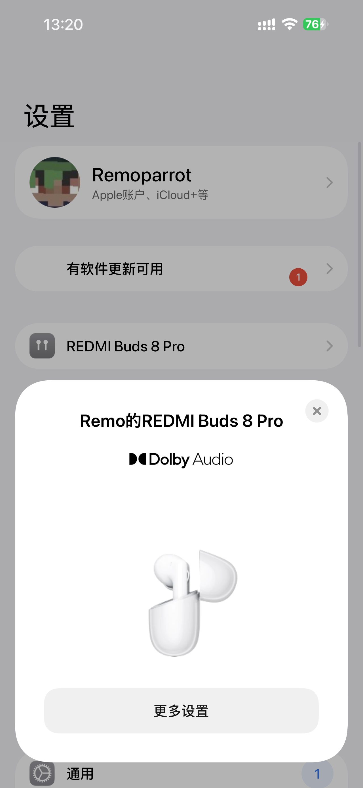
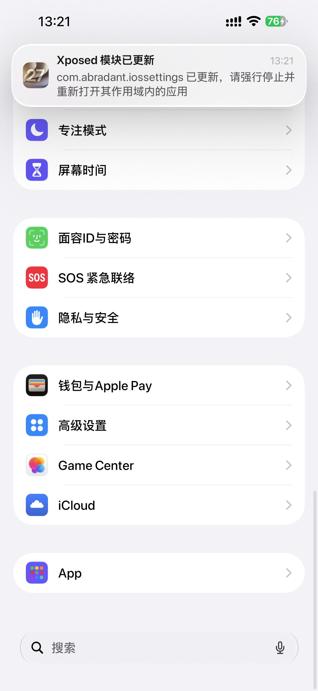
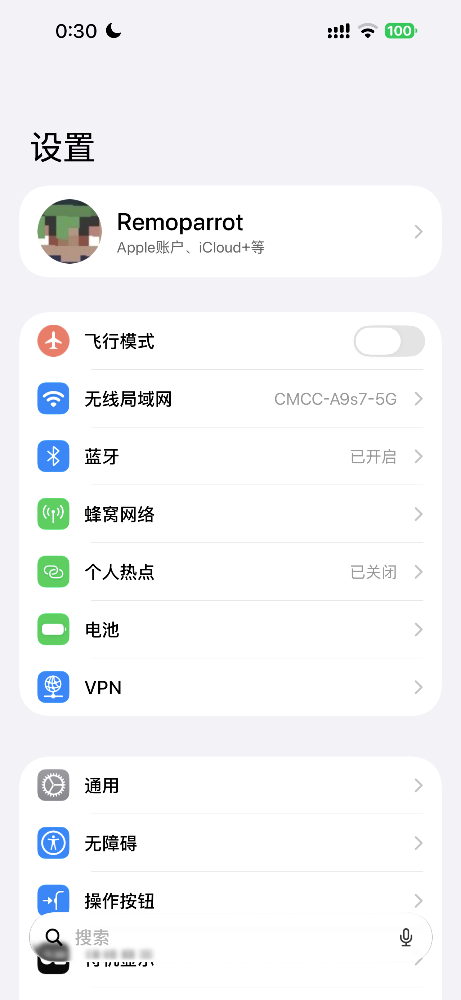
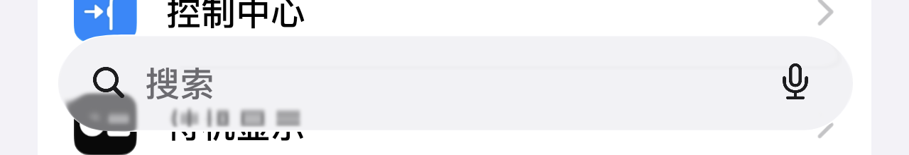
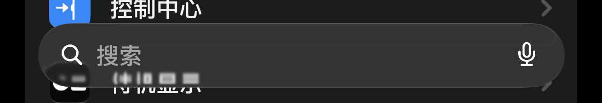
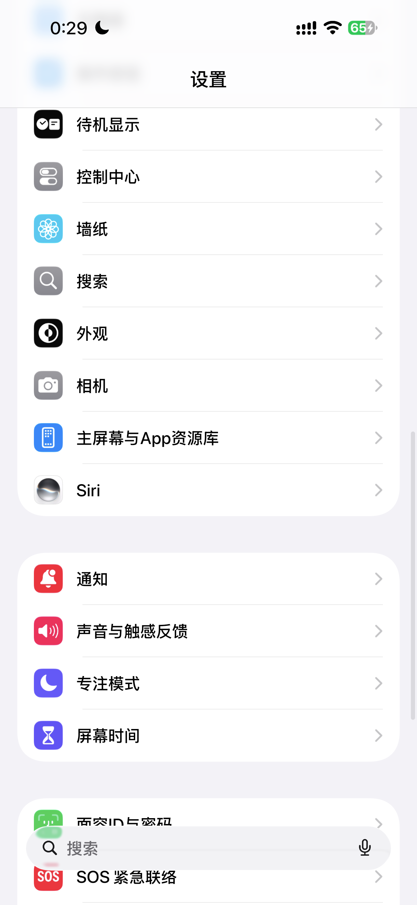
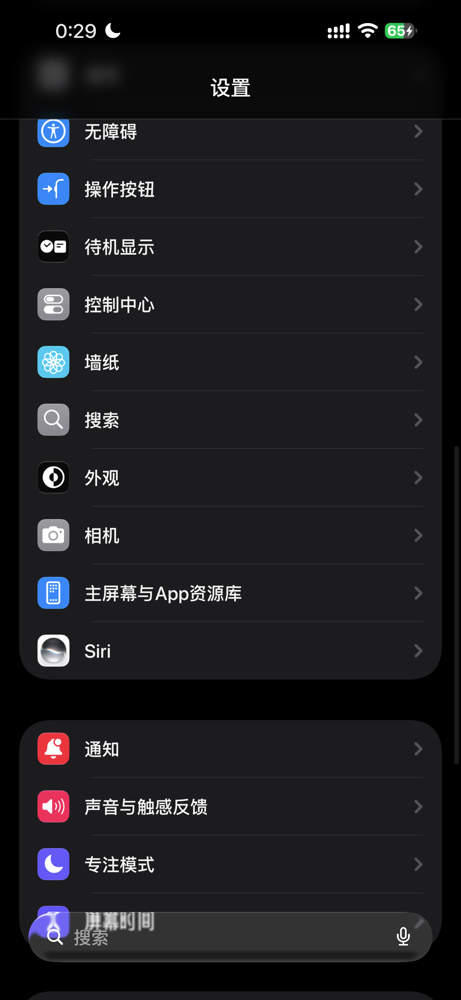
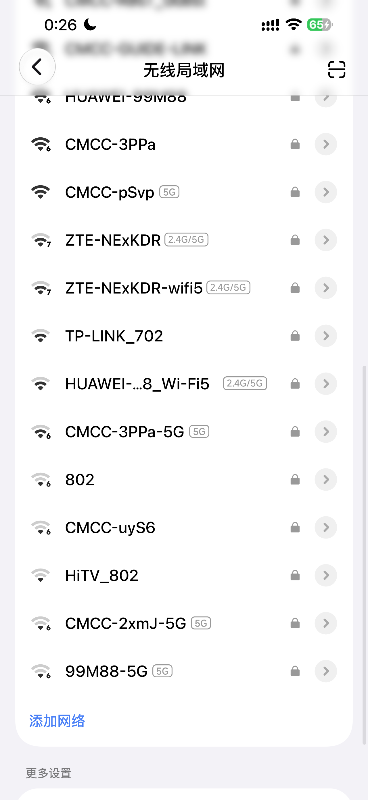
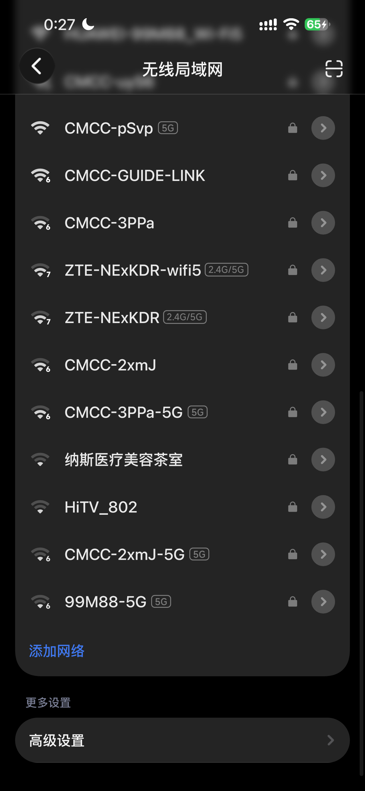
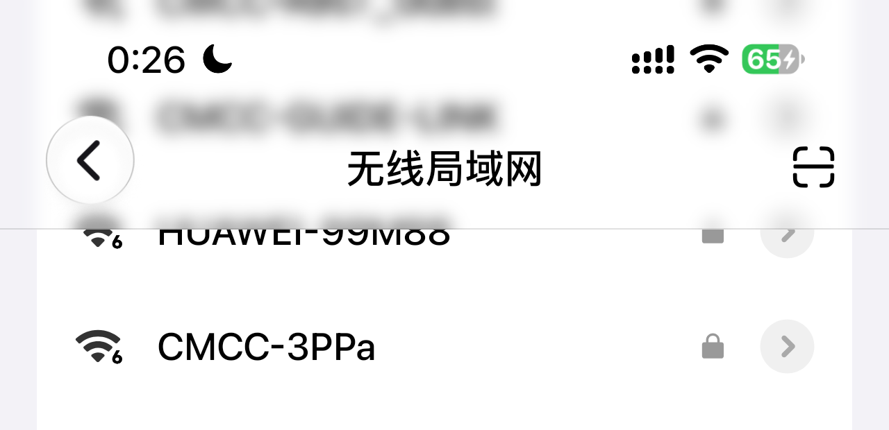

# iLayoutSettings · iOS 设置布局

> 把澎湃 OS（HyperOS 3）「设置」首页改成 iOS 风格：入口重排、条件卡片（软件更新 / 耳机 / iCloud）、搜索栏沉底、卡片细节修正。
> **全部复用 MIUI 原生控件与原生数据，模块不重绘任何页面。**

[](https://github.com/Remoparrot/iLayoutSettings/releases)
[](LICENSE)
[](docs/01-overview.md)
[](docs/04-install.md)

---

## 这是什么

一个运行在「设置」（`com.android.settings`）进程里的 **LSPosed 模块**。它只做三件事：

1. **重排**首页入口，并按 iOS 的分组重写 `Header.groupId`，让 miuix 自己把卡片画出来；
2. **按条件合成卡片**：有 OTA 时才出现的「有软件更新可用」、连着耳机时才出现的耳机卡、固定在 Game Center 下的 iCloud；
3. 把原生搜索栏**移到底部**，进出搜索时带过渡动画，点击行为仍然是 MIUI 自己的搜索。

背景、行样式、圆角、点击全部是系统原生的——所以它看起来像换了一套布局，而不是套了一层主题。

| 能力 | 说明 |
| --- | --- |
| 首页重排 / 分组 | iOS 顺序 + 独立卡片，卡片圆角与间距仍由 miuix `CardItemDecoration` 绘制；**16.7「控制中心」移到「墙纸」上方** |
| 软件更新卡（条件） | 读 `Settings.Global.miui_new_version`，非空才显示「有软件更新可用」+ 红色「1」角标，点击进系统更新；**16.6 起「通用」行的蓝 1 也换成同一颗红角标**，两行都带系统自带的箭头 |
| 耳机卡（条件） | 检测已连接的蓝牙/有线/USB 耳机，标题 = 设备别名；**连上/断开后即时刷新，不用重启设置**；没连耳机整张卡不出现，点击进 MIUI 耳机详情页（电量/改名/EQ） |
| iCloud 入口 | 固定在「Game Center」下方，点击打开小米云服务 |
| 条件卡图标 | 用指定资源包里的 `ic_cloud` / `ic_sub_airpods`（已打进模块）；设置同名 drawable 只作兜底 |
| 专注模式 / 相机 / 搜索入口 | 分别在「屏幕时间」「外观」「墙纸」附近，复用系统或模块图标 |
| 飞行模式开关 | 右侧原生 `SlidingSwitch`，图标优先用设置主题里的 `ic_airplane_mode_settings` |
| 底部搜索栏 | `miuix_appcompat_search_stub` 原生布局 + **自绘 Kyant 液态玻璃**（G2 连续圆角 + 模糊 + 折射 + 上下光边，不再叠 MIUI 9-patch） |
| 搜索栏图标 / 小爱 | 指定 iOS 27 搜索/麦克风图标，随深浅色染色；点麦克风走与电源键长按相同的 `VoiceService` 入口唤醒小爱 |
| 搜索栏过渡 | 进出搜索 220ms 滑动+缩放+淡入淡出；**退出时等 MIUI 收起顶部搜索框后再出现底部栏**，不再短暂出现两个搜索栏 |
| 参数界面 | 应用内滑杆：搜索栏模糊（0.1dp）/ 折射 19dp / 厚度 12dp；顶栏模糊 0–100%、顶栏透明度 0–100%、显示顶栏分割线（16.6 删除「高级设置」总开关，全部常显） |
| 卡片细节修正 | 去掉每组最后一行的双层圆角/放大图标；外观页预览加卡片底 |
| 顶部模糊 / 发丝线 | 默认 5% 模糊 + 2% 透明度，**顶栏始终带模糊**——账户卡等内容滑到栏下面就是糊的，不再被不透明栏切掉；发丝线跟着栏一起出现（浅色黑 12%，深色中性灰 30%）；**设置内切换深浅色后线不消失**，折叠栏第一次出现就带模糊 |
| 二级页顶栏（16.7） | 二级页顶栏与首页同一套参数：半透明底色 + 原生模糊 + 内容滑进栏下；0.5dp 半透明发丝线只在滚动时出现，回顶部即隐藏 |
| 应用图标 | 蓝紫渐变 + 半透明玻璃盘 + 白齿轮（[预览](docs/assets/icon-16.4.png)）；`tools/make_launcher_icon.py` 生成五档 mipmap，脚本内另有两套候选（[并排对比](docs/assets/icon-candidates-16.4.png)） |

## 截图

| 条件卡片（16.0：更新 + 耳机） | iCloud 入口（16.0） |
| --- | --- |
|  |  |

首页（账号 + 卡片分组）与搜索栏：

| 首页 | 搜索栏 · 浅色 | 搜索栏 · 深色 |
| --- | --- | --- |
|  |  |  |

16.7：控制中心移到墙纸上方，二级页顶栏半透明 + 模糊 + 发丝线：

| 首页 · 浅色 | 首页 · 深色 |
| --- | --- |
|  |  |

| 二级页顶栏 · 浅色（滚动后出现发丝线） | 二级页顶栏 · 深色 |
| --- | --- |
|  |  |

发丝线特写（浅色，列表滑到栏下时出现；回到顶部自动隐藏）：



## 安装

1. 下载 [`dist/iLayoutSettings-16.7.apk`](dist/iLayoutSettings-16.7.apk)，或到 [Releases · v16.7](https://github.com/Remoparrot/iLayoutSettings/releases/tag/v16.7) 下同名附件（298,530 B，SHA-256 `25E0FCA8…D973`，与 `dist/` 同一份）；
   **16.0 起包名是** `com.Remo.ilayoutsettings`，从 16.0 升级可直接覆盖（同一签名）；
2. LSPosed 中启用 **iLayoutSettings**，作用域只勾选 **设置**（`com.android.settings`）；
3. **强制停止「设置」**（或重启手机），再打开设置；
4. 打开桌面上的 **iLayoutSettings** 图标即可调参数（搜索栏模糊 / 折射 / 厚度；顶栏模糊 / 透明度 / 发丝线开关）。

> 本机 MIUI 会拦截 adb 安装新包（`INSTALL_FAILED_USER_RESTRICTED`）：把 APK 复制到手机后
> 在文件管理器里点开安装即可；或在开发者选项里允许「USB 安装」。
> 旧版本 15.5 / 14.8 仍在各自 Release 里（14.8 证书不同）。

日志过滤 `iLayoutSettings` 应能看到 `hooks installed`、`top bar hooks installed`、
`hooked MiuiBlurUiHelper (header radius + refreshBlur)`、`hooked sub-page activity bases`、
`sub-page action bar overlay mode on`、`icloud row added below Game Center`、
按条件出现的 `update card added: …` / `airpods card added: …`、`headset devices changed, refresh cards`，
以及 `card icon … <- module (supplied theme)`、`liquid glass shader compiled`、
`search glass mask=...`、`airplane icon set: ...`。
详见 [安装与调试](docs/04-install.md)。

## 兼容性

| 项 | 值 |
| --- | --- |
| 系统 | 澎湃 OS 3（HyperOS 3）· Android 15/16 |
| 目标进程 | `com.android.settings`（仅此一个作用域） |
| 模块 | Xposed API 82 / LSPosed 1.x、2.x |
| minSdk / targetSdk | 29 / 36 |
| 设备 | 手机；平板/分屏未专门适配（欢迎反馈） |

## 从源码构建

不需要 Gradle，`aapt2 → javac → d8 → zipalign → apksigner` 一条 PowerShell 脚本：

```powershell
pwsh -File module/build.ps1 `
  -Jdk C:\jdk17 `
  -BuildTools C:\android-sdk\build-tools\34.0.0 `
  -AndroidJar C:\android-sdk\platforms\android-36\android.jar
```

输出 `dist/iLayoutSettings-<versionName>.apk`。
发版用 `tools/release.ps1 -Version 16.7`：构建 → 校验 → 自动提交/推送 → 打 tag → 建 Release → 上传 APK，一条命令完成。
完整工具链版本、可复现性说明见 [构建指南](docs/03-build.md)。

## 文档

- **第一次来 / 新开一个 AI 会话** → [agent.md](agent.md) → [文档地图](docs/README.md) → [当前状态](docs/00-status.md)
- 想改代码 → [架构](docs/02-architecture.md) + [设计思路](docs/05-design-notes.md) + [踩坑记录](docs/06-pitfalls.md)
- 出问题了 → [排错手册](docs/08-troubleshooting.md)
- 想看历史版本 → [版本记录](docs/07-changelog.md)

## 协作与记录（重要）

本仓库把「文档」当成项目的一部分，而不是附属品：

- 每次对话/AI 会话结束前，**必须**在 [`docs/sessions/`](docs/sessions/) 写一份会话记录（重点、修复、设计、踩坑、验证），规则见 [agent.md](agent.md)；
- 版本变化同步更新 [版本记录](docs/07-changelog.md)，新坑同步更新 [踩坑记录](docs/06-pitfalls.md)；
- 新增文档必须登记到 [文档地图](docs/README.md)。

**新开一个对话时，把这句话发给 AI：**

> 读 `agent.md`、`docs/00-status.md`、`docs/README.md` 和 `docs/sessions/` 最新一份记录，
> 先用 5 行给我接手确认，在我确认之前不要改代码。

这样下一次开新对话时，读三份文件就能无缝接手。

## 许可与致谢

- 代码：[GPL-3.0](LICENSE)；
- 图标为自制（`tools/make_subpage_icons.py` / `tools/make_launcher_icon.py` 生成），仅参考 iOS 视觉风格；Apple / iOS 是 Apple Inc. 的商标，本项目与其无关；
- 玻璃/折射实现参考了 [kyant0/AndroidLiquidGlass](https://github.com/Kyant0/AndroidLiquidGlass)（Apache-2.0）与 [kyant0/Shapes](https://github.com/Kyant0/Shapes)（Apache-2.0），第三方声明见 [NOTICE.md](NOTICE.md)。

---

<sub>仓库名 `iLayoutSettings`（旧名 `iLyayot`），应用名 **iLayoutSettings**，包名 `com.Remo.ilayoutsettings`。</sub>
