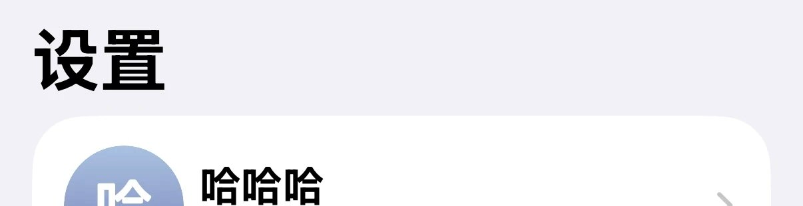
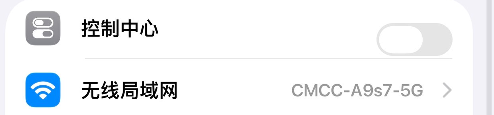
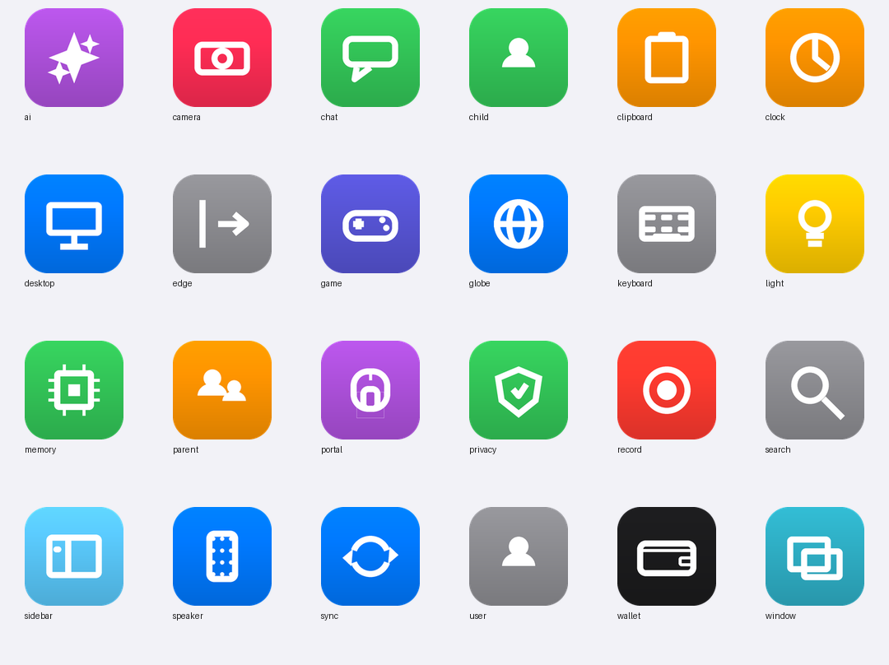

# iLyayot · iOS 设置布局

> 把澎湃 OS（HyperOS 3）「设置」首页改成 iOS 风格：入口重排、二级页图标、搜索栏沉底、卡片细节修正。
> **全部复用 MIUI 原生控件与原生数据，模块不重绘任何页面。**

[](https://github.com/abradanthawk-design/iLyayot/releases)
[](LICENSE)
[](docs/01-overview.md)
[](docs/04-install.md)

---

## 这是什么

一个运行在「设置」（`com.android.settings`）进程里的 **LSPosed 模块**。它只做三件事：

1. **重排**首页入口，并按 iOS 的分组重写 `Header.groupId`，让 miuix 自己把卡片画出来；
2. 给二级页面（通用、更多设置……）**补图标**，图标资源内置在模块里；
3. 把原生搜索栏**移到底部**，点击行为仍然是 MIUI 自己的搜索。

背景、行样式、圆角、点击、动画全部是系统原生的——所以它看起来像换了一套布局，而不是套了一层主题。

| 能力 | 说明 |
| --- | --- |
| 首页重排 / 分组 | iOS 顺序 + 独立卡片，卡片圆角与间距仍由 miuix `CardItemDecoration` 绘制 |
| 飞行模式开关 | 在「控制中心」行右侧放一个原生 `SlidingSwitch`，行点击仍是原逻辑 |
| 二级页图标 | 24 个 iOS 风格图标，按 preference key 匹配，标题关键词兜底 |
| 底部搜索栏 | `miuix_appcompat_search_stub` 原生布局，带玻璃/模糊底层 |
| 卡片细节修正 | 去掉每组最后一行的双层圆角/放大图标；外观页预览加卡片底 |
| 顶部模糊 | 列表滚动时才出现，可调半径 |
| 关于本机 | （历史能力）iOS 风格「关于设备」页，见 [版本记录](docs/07-changelog.md) |

## 截图

| 首页（账号 + 卡片分组） | 控制中心行的飞行模式开关 | 二级页图标 |
| --- | --- | --- |
|  |  |  |

## 安装

1. 下载 [`dist/IosSettingsLayout-14.8.apk`](dist/IosSettingsLayout-14.8.apk)（或到 [Releases · v14.8](https://github.com/abradanthawk-design/iLyayot/releases/tag/v14.8) 下载）；
2. LSPosed 中启用模块，作用域只勾选 **设置**（`com.android.settings`）；
3. **强制停止「设置」**（或重启手机），再打开设置。

日志过滤 `IosSettings` 应能看到 `hooks installed`。详见 [安装与调试](docs/04-install.md)。

> 从旧版本升级时若提示「应用未安装 / 签名不一致」，先卸载旧包再装。原因见 [踩坑记录 · 签名](docs/06-pitfalls.md#签名与升级)。

## 兼容性

| 项 | 值 |
| --- | --- |
| 系统 | 澎湃 OS 3（HyperOS 3）· Android 15/16 |
| 目标进程 | `com.android.settings`（仅此一个作用域） |
| 模块 | Xposed API 82 / LSPosed 1.x、2.x |
| minSdk / targetSdk | 29 / 36 |
| 设备 | 手机；平板/分屏未专门适配（欢迎反馈） |

## 从源码构建

不需要 Gradle，`aapt2 → javac → d8 → zipalign → apksigner` 一条 PowerShell 脚本：

```powershell
pwsh -File module/build.ps1 `
  -Jdk C:\jdk17 `
  -BuildTools C:\android-sdk\build-tools\34.0.0 `
  -AndroidJar C:\android-sdk\platforms\android-36\android.jar
```

输出 `dist/IosSettingsLayout-14.8.apk`。完整工具链版本、可复现性说明见 [构建指南](docs/03-build.md)。

## 文档

- **第一次来 / 新开一个 AI 会话** → [agent.md](agent.md) → [文档地图](docs/README.md) → [当前状态](docs/00-status.md)
- 想改代码 → [架构](docs/02-architecture.md) + [设计思路](docs/05-design-notes.md) + [踩坑记录](docs/06-pitfalls.md)
- 出问题了 → [排错手册](docs/08-troubleshooting.md)
- 想看历史版本 → [版本记录](docs/07-changelog.md)

## 协作与记录（重要）

本仓库把「文档」当成项目的一部分，而不是附属品：

- 每次对话/AI 会话结束前，**必须**在 [`docs/sessions/`](docs/sessions/) 写一份会话记录（重点、修复、设计、踩坑、验证），规则见 [agent.md](agent.md)；
- 版本变化同步更新 [版本记录](docs/07-changelog.md)，新坑同步更新 [踩坑记录](docs/06-pitfalls.md)；
- 新增文档必须登记到 [文档地图](docs/README.md)。

这样下一次开新对话时，读三份文件就能无缝接手。

## 许可与致谢

- 代码：[GPL-3.0](LICENSE)；
- 图标为自制（`tools/make_subpage_icons.py` 生成），仅参考 iOS 视觉风格；Apple / iOS 是 Apple Inc. 的商标，本项目与其无关；
- 玻璃/折射实现的思路参考了 kyant0 的液态玻璃与 lattice 的实现，第三方声明见 [NOTICE.md](NOTICE.md)。

---

<sub>仓库名 `iLyayot`，应用名「iOS 设置布局」，包名 `com.abradant.iossettings`。</sub>
