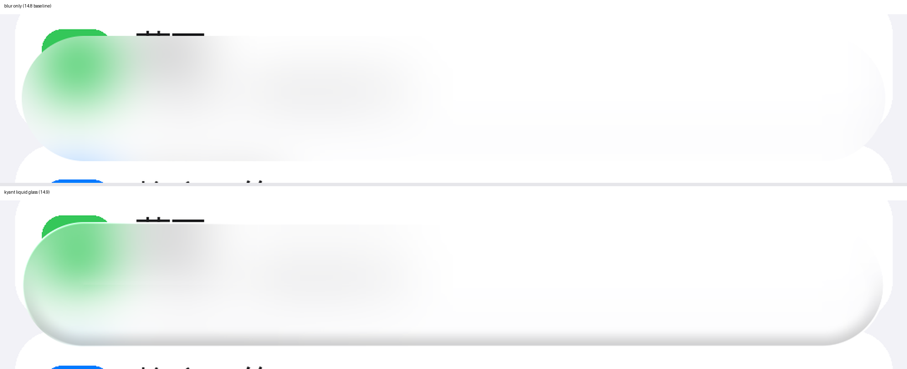
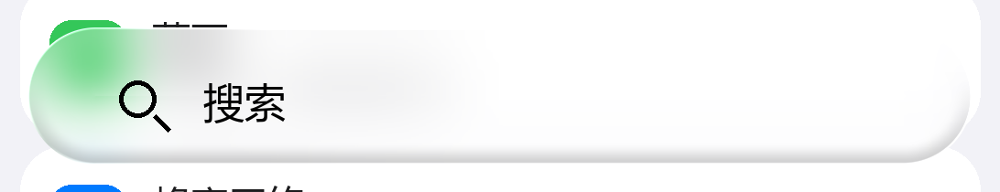

# 搜索栏接入 Kyant 液态玻璃（2026-11-09）

状态：已完成
关联版本：14.8 → 14.9（83 → 84）
关联提交：本记录所在提交（见 `git log --oneline -1`）

## 1. TL;DR

底部搜索栏从「抓背景 + 10dp 模糊」升级成 Kyant0 的液态玻璃合成：模糊 → 圆角矩形折射（AGSL）→ 45° 边缘高光 → 底部内阴影，全部裁在 50dp 胶囊内。
AGSL 用 Skia 编译器离线校验通过（`javac` 不校验 shader），构建出 14.9 预览包并做了 APK 四项校验，但**没有真机/模拟器实测**。
版本号先不动 dist 的 14.8 发布包，14.9 以预览包形式给出。

## 2. 对话重点

- **用户要求（原话）**：「给搜索栏添加 GitHub@kyant0 的液态玻璃」。
- **决策**：
  - 直接按 `ios-settings-mod/kyant_src/` 里那份 Kyant0/AndroidLiquidGlass 源码（Apache-2.0）移植 `Shaders.kt` / `Lens.kt` / `HighlightStyle.Default` / `InnerShadow` 的数学，而不是把旧 `SearchGlass` 里 `if (false)` 的折射分支简单打开；
  - 把 rim highlight 与 inner shadow **折进同一个 AGSL**，一层 RenderNode 出图，避免 16.8 那种「折射 + 描边 + 内阴影」三层各自 clip 的叠加误差与额外开销；
  - 保留「抓图 → 模糊 → 折射」顺序：Kyant 的 glass 一直是 blur + lens 两段，只做 lens 会像放大镜而不是玻璃。
- **否决**：
  - 色散（`chromaticAberration`）：每像素 7 次纹理采样，120Hz 抓图管线扛不住，`Prefs.CHROMATIC` 键保留但 shader 不读；
  - 恢复 lattice 的 `LiquidGlassView`：16.x 已在真机上翻过车（文字重影、图标缺失，见 `07-changelog.md`），继续用自己的 `SearchGlass`。
- **范围外但被提到**：GUI 参数页仍未恢复；本次只改默认参数，后续如需可调再按路线图单独开分支。

## 3. 修复内容

| 文件 | 改了什么 | 为什么 |
| --- | --- | --- |
| `module/src/.../SearchGlass.java` | 重写绘制管线：`capture → blurNode(10dp BlurEffect) → lensNode(RuntimeShaderEffect)`，新增 45° rim、底部内阴影、`outerSign`、unpremul、三层 fallback | 14.8 的 `drawBlurred` 只画模糊；旧 `if (false)` 分支的折射没有和高光/内阴影合成，且 SDF 用的是整条 bar 而不是胶囊 |
| 同上 | 抓图 padding 4dp → 16dp（`CAPTURE_PAD_DP`），节点比胶囊四周各大 `blur+2px` | 模糊需要胶囊外的真实像素，否则边缘是 clamp 拉出来的条纹 |
| 同上 | 所有 RenderNode 改成 `setPosition(0,0,w,h)` + `canvas.translate()` 摆放 | 节点在另一个节点里 `drawRenderNode()` 时，position 会被再叠加一次，造成内容错位一整个 pad |
| 同上 | AGSL 里 `sign(coord)` → `outerSign(coord)`，去掉 seamFade | `sign(0)` 会让法线退化成零向量；seamFade 又会把中线附近的位移拉成 0，反而在条中间留一条横向接缝 |
| 同上 | 新增 `LENS_ONLY_AGSL` 与 `shaderUnavailable` / `glassActiveLogged` 状态 | 全量 shader 被驱动拒绝时退「只有折射」，再退「只有模糊」，再退「半透明底」，不让搜索栏消失 |
| `module/src/.../Prefs.java` | 新增 `GLASS_BLUR` / `RIM_ALPHA` / `RIM_WIDTH` 键；默认值改 18dp / 10dp / 0.18 / 8dp / 10dp / 0.5 / 1dp | 50dp 高的胶囊用 40dp 折射厚度会把整条 bar 都弯掉；新默认值只弯边缘 |
| `module/AndroidManifest.xml` | `versionCode 84` / `versionName 14.9` | 功能变化，按 `agent.md` §6 一次做齐 |
| `module/src/.../MainActivity.java` | 副标题 `v14.8` → `v14.9` | 版本号唯一来源之外的展示文案 |
| `README.md` / `docs/*` | 版本、状态、架构、设计思路、坑、changelog 同步 | `agent.md` 第 4 节的强制同步清单 |

## 4. 设计思路

**问题本质**：14.8 的搜索栏只有「模糊 + 半透明」，看起来是磨砂而不是玻璃；Kyant 的观感来自三件事——边缘折射（lens）、边缘高光（rim）、底部内阴影（厚度），缺一件就像贴纸。

- **为什么把 rim/shadow 写进 shader**：
  16.8 的做法是「折射节点 + 描边节点 + 内阴影节点」，每层都要自己裁胶囊，边缘抗锯齿各算各的，容易出现 1px 亮边/暗边。折进 shader 后只有一个输出，SDF 同时决定折射位移、rim 宽度和内阴影带，三者天然对齐，也少两次 RenderNode 合成。
- **节点位置为什么归零**：
  `RenderNode.setPosition()` 描述的是节点在父坐标里的位置，`Canvas.drawRenderNode()` 在录制另一个节点时会把这层位置算进去。最初把 blur 节点放在 `(-pad,-pad)` 再录进 lens 节点，等于平移了两次。统一 `setPosition(0,0)`、在 `drawNodeAt()` 里 `translate(left,top)`，两种语义下都对。
- **为什么 `outerSign` 而不是 `sign`**：
  `sign(0)=0` 会把 SDF 法线的某个分量清零，胶囊中线/正中点上梯度退化，采到无效坐标 → 15.8.1 那条「正中一条线」。`outerSign` 永远返回 ±1，配合长度兜底，既没有零向量也没有接缝，还不需要 seamFade 那种「把位移拉回 0」的补丁。
- **兜底顺序**：全量 shader → 只有折射 → 只有模糊 → 半透明胶囊。任何一层抛异常都只降级、不让搜索栏消失（这是 15.9 的教训）。

**取舍**：观感 vs 性能。抓图仍是 0.6×、8ms 一帧；多出来的是两次 RenderEffect（blur + runtime shader），比 16.x 的三层合成少一层。没有做色散与 vibrancy，避免每像素多次采样。

## 5. 踩过的坑

### 坑：AGSL 里自定义 `unpremul` 和 SkSL 内置函数重名

- **现象**：把 shader 贴进 Skia（`skia-python` 的 `RuntimeEffect.MakeForShader`）编译，直接报
  `functions 'float3 unpremul(half4 c)' and '$pure half4 unpremul(half4 a)' differ only in return type`，随后一串 `unknown identifier`。
- **根因**：SkSL 内置了 `$pure half4 unpremul(half4)`，同名不同返回类型不允许重载。
- **解法**：改名 `unpremulColor`。
- **如何避免**：AGSL 的自定义函数别用 `unpremul` / `pack` / `saturate` 这类像内置的名字；改完先在 Skia 里编译一遍。

### 坑：`javac` 通过 ≠ shader 能编译

- **现象**：Java 编译、d8、打包全部成功，但 AGSL 是运行期才编译的，真机上才可能抛异常。
- **根因**：AGSL 以字符串形式进 dex，构建链里没有任何一步会校验它。
- **解法**：本机装 `skia-python`，用 `RuntimeEffect.MakeForShader(源码)` 离线编译，并核对 `effect.uniforms()` 的名字/顺序与 Java 里 `setFloatUniform` 完全一致。
- **如何避免**：以后改 shader 先跑这个检查；本次已固化成 `tools/check_agsl.py`（需要 `skia-python`）。

### 坑：RenderNode 位置被算两次，玻璃内容整体偏移

- **现象**：设计阶段按「节点 position=(-pad,-pad) + drawRenderNode」推演，pads 会叠加成两倍位移；模糊底图和折射采样错位一整个 pad。
- **根因**：`RenderNode.setPosition()` 与 `Canvas.drawRenderNode()` 的坐标语义容易混——节点被录进另一个节点时仍带自己的 position。
- **解法**：节点统一 `(0,0,nodeW,nodeH)`，摆放交给 `canvas.translate`。
- **如何避免**：RenderNode 只用一种摆放方式，别混用 position 和 translate。

### 坑：sim 预览里的「横线」其实是页面内容

- **现象**：numpy 预览里胶囊中部有一条横向分层，第一反应是折射接缝。
- **根因**：测试页在 bar 中间正好有一条色带边界（黄→白），模糊后就是横向分层；逐行梯度统计里没有尖峰，折射前后差异只有 1/255。
- **解法**：用「逐行 |Δ| 统计 + 与无折射版本的差分」判断接缝，而不是凭缩略图感觉。
- **如何避免**：视觉排查要有对照图和数值指标。

## 6. 验证与证据

构建：

```powershell
powershell.exe -NoProfile -ExecutionPolicy Bypass -File module\build.ps1 `
  -OutDir 'build\out' `
  -AndroidJar 'C:\Users\AbradantHawk\Documents\deepseek-harness\default-workspace\ios-settings-mod\.tools\platform36\android-36.1\android.jar'
```

输出：

```
version     : 14.9 (84)
dex version : 039
xposed_init : True
module class: True
reorder     : True
size        : 199561 bytes
sha256      : 6010AAC2CED9A9375910EDEAAAA10168B4BFD2F022D6FAC84538AB3AEE12E40A
dex size    : 134592 bytes
证书 SHA-256 : 941e18c51012be17f592ae25847a341d165bf77a27f9bc5a1b2e3ad14895248c（.keystore/testkey.jks）
```

该产物已复制为 `dist/IosSettingsLayout-14.9.apk`（仓库里的就是这份）；重编同一 commit 的 sha256 会变（zip 时间戳），
记录以仓库里这份为准。

Shader 校验（skia-python 144.1，SkSL 编译器与 Android 同源）：

```
LIQUID_GLASS_AGSL OK  uniforms: [size, offset, cornerRadii, refractionHeight, refractionAmount,
 depthEffect, rimColor, rimAngle, rimFalloff, rimWidth, shadowColor, shadowBand]  children: [content]
LENS_ONLY_AGSL    OK  uniforms: [size, offset, cornerRadii, refractionHeight, refractionAmount, depthEffect]
```

预览（numpy 复刻同一套公式，非真机截图）：

- 
- 

**未验证**：

- 没有真机或模拟器安装，实际观感、120Hz 下的帧率、深色模式、原生 stub 9-patch 与玻璃的边界对齐都**未上机验证**；
- 未验证 HyperOS 3 上 `RuntimeShader` 是否真的接受全量 shader（若被拒，会静默退到「只有折射」，日志里是 `full liquid glass shader rejected`）；
- 未验证与 14.8 的覆盖安装（签名仍是 `.keystore/testkey.jks`，与 14.8 发布包证书不同，覆盖安装会失败）。

## 7. 未完成 / 下一步 / 风险

- **未完成**：
  - 真机回归（观感、帧率、深色、边缘对齐）；
  - 参数 GUI（`Prefs` 键已经就位，但没有界面）；
  - 色散/vibrancy（按住性能预算没做）；
  - 旧工作目录 `ios-settings-mod/module` 没有同步（仍是 14.8 的实现），**以 `iLyayot` 为准**。
- **下一步（按顺序）**：
  1. 装 `dist/IosSettingsLayout-14.9.apk`，日志过滤 `IosSettings`，确认出现 `liquid glass shader compiled` 与 `liquid glass active`；
  2. 看 120Hz 下 `search glass capture fps=` 是否还在 60 以上；
  3. 观感 OK 后再决定是否把 14.9 放进 `dist/` 并更新 Release；
  4. 如需微调，只改 `Prefs.DEFAULT_*`，别动 shader 结构。
- **风险**：
  - 这是**没有设备实测**的视觉改动，最坏情况是玻璃整体发灰或边缘对不上原生 stub；
  - 两个 RenderEffect 叠加在低端机上可能掉帧，`nextCaptureAt` 有自适应但没实测；
  - `RuntimeShader` 在部分 GPU/驱动上会被拒，届时只剩模糊（观感回退到 14.8）。

## 更新清单

- [x] `docs/sessions/README.md` 索引已登记
- [x] `docs/00-status.md` 已更新
- [x] 受影响的专题文档已更新（架构 / 设计思路 / 坑 / changelog / README）
- [x] 版本号 14.8 → 14.9，构建产物 sha256 已记录
